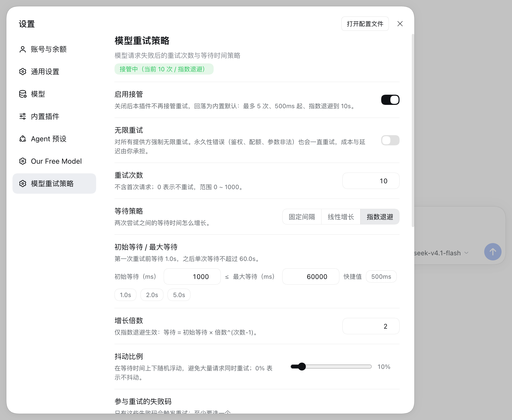

# dsh-retry-policy —— 模型重试策略

[](https://github.com/jinxiqinghuan/dsh-retry-policy/actions/workflows/ci.yml)
[](https://github.com/jinxiqinghuan/dsh-retry-policy/tags)
[](LICENSE)
[](package.json)
[](#10-兼容性)

> DSH（DeepSeek Harness）插件：**接管模型请求失败后的重试**，把「重试几次」和
> 「每次等多久」变成设置页里随时可改、保存即生效的策略，而不是适配器注册时写死的
> 5 次 + 固定指数退避。



<p align="center"><sub>DSH Web → 设置 → 模型重试策略：接管开关、重试次数、等待曲线、等待上下限、
增长倍数与抖动都在这一页（截图为页面上半部分，失败码、实时预览与保存按钮在下方）。</sub></p>

## 亮点

- **重试预算可调**：`0 ~ 1000` 次，或对提供方强制无限重试。
- **三种等待曲线**：固定间隔 / 线性增长 / 指数退避，带增长倍数、单次上限与抖动。
- **失败码可选**：从 10 种失败码里挑参与重试的集合；默认沿用官方 5 种。
- **优先听 `Retry-After`**：提供方给了就按它等，且不会超过最大等待。
- **保存即生效**：设置页通过 `configEditor` 写入 profile 用户补丁，无需重启。
- **界面零改动**：继续写官方同款的 `llm/retry` / `llm/retry-started` 事件与 `llmRetry`
  会话投影，会话气泡、轨迹视图、会话格式迁移都不用改。
- **纯 JavaScript**：无构建步骤、无第三方运行时依赖、不访问外网。

## 目录

- [1. 它解决什么问题](#1-它解决什么问题)
- [2. 安装](#2-安装)
- [3. 快速配置](#3-快速配置)
- [4. 等待时间策略](#4-等待时间策略)
- [5. 工作原理](#5-工作原理)
- [6. 行为细节](#6-行为细节)
- [7. 已知边界](#7-已知边界)
- [8. 常见问题](#8-常见问题)
- [9. 安全与隐私](#9-安全与隐私)
- [10. 兼容性](#10-兼容性)
- [11. 文件结构](#11-文件结构)
- [12. 开发与自检](#12-开发与自检)
- [13. License](#13-license)

## 1. 它解决什么问题

DSH 默认的模型请求重试完全由 provider 适配器配置里的 `retryPolicy` 决定：

| 项 | 默认值 | 出处 |
|---|---|---|
| 模式 | `normal`（有限次） | `@deepseek-ai/dsh-llm` 的 `resolveRetryPolicy()` |
| 重试次数 | **5** | 同上（`DEFAULT_MAX_RETRIES = 5`） |
| 首次等待 / 上限 | 500 ms / 10 000 ms | 同上 |
| 抖动 | 10% | 同上 |
| 参与重试的失败码 | `EMPTY_RESPONSE` `RATE_LIMIT` `SERVER` `TIMEOUT` `TRANSPORT` | 同上 |

这份策略是适配器**注册路由时快照**下来的，运行期改不了；执行重试的
`@deepseek-ai/dsh-llm-retry` 自己也没有任何配置项
（它的 `Config` 只用来报错：`retryPolicy belongs under each provider configuration`）。

结果就是：**失败 5 次就放弃，等待曲线也改不了**。

本插件的做法：

```
bundle patch:
  ├─ id: llm-retry      disabled: true          # 关掉内置执行器
  └─ insert: dsh-retry-policy                    # 挂上本插件，由它接管
```

本插件读取自己的配置（次数 + 等待策略），复刻官方的判定顺序、事件字段集、会话投影与
「延迟可取消、释放时排空」语义，因此对上层完全透明。

## 2. 安装

### 2.1 从 GitHub 安装（推荐）

```bash
# 方式一：让 Agent 用插件管理器装（自动加进 profile 的 bundle 列表）
#   plugin_manager { action: "install_bundle", target: "github:jinxiqinghuan/dsh-retry-policy#v0.1.0" }

# 方式二：dsh CLI
dsh plugin --profile desktop add "github:jinxiqinghuan/dsh-retry-policy#v0.1.0"
```

- 仓库所属 GitHub 用户名为 `jinxiqinghuan`；fork / 迁移后把上面的用户名换掉即可。
- 建议锁定版本（`#v0.1.0`）；想跟最新代码就去掉 `#v0.1.0`。
- 安装时先做 GitHub 连接检查，再交给 pnpm；网络受限时先配好代理。
- 装完刷新页面（⌘R）——客户端半边需要页面重载一次才会出现在「设置」里。

### 2.2 本地开发安装

已经装进 `desktop` profile 的话可以跳过。

```bash
# 方式一：让 Agent 用插件管理器装（推荐）
#   plugin_manager { action: "install_bundle", target: "/绝对路径/dsh-retry-policy" }

# 方式二：命令行
dsh plugin --profile desktop add "link:/绝对路径/dsh-retry-policy"
```

宿主半边由 `dsh-hmr` 监听 profile `package.json` 自动重算，通常无需重启 app。

### 2.3 装完怎么确认

1. 打开 `设置（左下角齿轮）→ 模型重试策略`，页面应显示
   「接管中（当前 10 次 / 指数退避）」，并列出各项配置。
2. 打开一个会话发一条消息，确认会话正常；重试发生时会话里会出现官方的
   「模型重试」节点。
3. 若设置页没出现：确认 profile 的 bundle 列表里有 `dsh-retry-policy`，
   然后刷新页面；仍不行就查看宿主日志里的客户端 slot 报错。

### 2.4 卸载 / 回退

```bash
dsh plugin --profile desktop remove dsh-retry-policy
```

移除 bundle 后，bundle patch 里被禁用的内置 `llm-retry` 会恢复启用，重试回到官方默认
（5 次 / 500→10 000 ms / 抖动 10%）。如果 `~/.dsh/profiles/desktop/cordis.patch.yml`
里还留着本插件的用户层配置行，把它一并删掉即可。

## 3. 快速配置

### 3.1 设置页（推荐）

`设置（左下角齿轮）→ 模型重试策略`：

1. **启用接管** —— 关掉 = 退回内置默认策略（normal / 5 次 / 500→10 000 / 抖动 10%）。
2. **无限重试**（`mode: always`）—— 一直重试到成功、取消或插件卸载；对永久性错误
   （鉴权、配额、参数非法）也会一直重试，成本与延迟自负。
3. **重试次数** `maxRetries`（0~1000，不含首次请求）。
4. **等待策略**：固定间隔 / 线性增长 / 指数退避。
5. **初始等待 / 最大等待 / 增长倍数 / 抖动比例**。
6. **参与重试的失败码**多选（10 选 N，至少 1 个）。
7. **优先听提供方 `Retry-After`**。
8. **实时预览**：`第 1 次 1.0s → 第 2 次 2.0s → …`，含累计等待。

保存经 `configEditor` 写进 profile 的用户层补丁（`cordis.patch.yml`），
走 Loader 正常重载路径即时生效，重启后仍在。

### 3.2 场景预设

| 场景 | `mode` | `maxRetries` | `strategy` | 初始 / 最大等待 | `multiplier` | `jitterRatio` |
|---|---|---|---|---|---|---|
| 默认（推荐） | `inherit` | 10 | `exponential` | 1000 / 60000 | 2 | 0.1 |
| 快速失败，少等待 | `inherit` | 3 | `linear` | 500 / 5000 | — | 0 |
| 弱网 / 长任务 | `always` | 忽略 | `exponential` | 2000 / 300000 | 2 | 0.2 |
| 只补一次 | `inherit` | 1 | `fixed` | 2000 / 2000 | — | 0 |
| 完全不重试 | `inherit` | 0 | 任意 | 任意 | — | — |

预设只是起点：改完点保存，预览会用同一套公式立刻给出新的等待序列。

### 3.3 直接改补丁

```yaml
# ~/.dsh/profiles/desktop/cordis.patch.yml
- id: dsh-retry-policy
  name: dsh-retry-policy
  config:
    enabled: true
    mode: inherit          # inherit | always
    maxRetries: 10
    strategy: exponential  # exponential | linear | fixed
    initialDelayMs: 1000
    maxDelayMs: 60000
    multiplier: 2
    jitterRatio: 0.1
    retryableCodes: [EMPTY_RESPONSE, RATE_LIMIT, SERVER, TIMEOUT, TRANSPORT]
    respectRetryAfter: true
```

### 3.4 字段速查

| 字段 | 类型 | 默认 | 说明 |
|---|---|---|---|
| `enabled` | boolean | `true` | `false` = 不接管，用内置默认策略 |
| `mode` | `inherit` \| `always` | `inherit` | `always` = 强制无限重试（提供方本身声明 `always` 时也会无限） |
| `maxRetries` | int 0~1000 | `10` | 有限模式下的重试预算 |
| `strategy` | `exponential` \| `linear` \| `fixed` | `exponential` | 等待曲线 |
| `initialDelayMs` | int 1~3 600 000 | `1000` | 首次等待 |
| `maxDelayMs` | int ≥ `initialDelayMs` | `60000` | 单次等待上限 |
| `multiplier` | number 1~100 | `2` | 仅指数策略使用 |
| `jitterRatio` | number 0~1 | `0.1` | 对称抖动比例 |
| `retryableCodes` | string[] | 官方 5 个码 | 非空、去重；可从 10 种失败码里选 |
| `respectRetryAfter` | boolean | `true` | 提供方 `Retry-After` 不超过 `maxDelayMs` 时优先采纳 |

可选失败码：`EMPTY_RESPONSE`、`RATE_LIMIT`、`SERVER`、`TIMEOUT`、`TRANSPORT`、`AUTH`、`QUOTA`、`INVALID_REQUEST`、`PROTOCOL`、`CONTEXT_OVERFLOW`。

## 4. 等待时间策略

```
第 n 次重试（n 从 1 开始）：
  fixed:        base = initialDelayMs
  linear:       base = initialDelayMs * n
  exponential:  base = initialDelayMs * multiplier ** min(n - 1, 64)

  base     = min(base, maxDelayMs)
  jittered = base * (1 - jitterRatio + 2 * jitterRatio * rand)   # rand ∈ [0,1)
  delay    = clamp(round(jittered), 1, maxDelayMs)
```

示例（`initialDelayMs = 1000`、`maxDelayMs = 60000`、`jitterRatio = 0`）：

| 策略 | 第 1~6 次等待（秒） |
|---|---|
| `fixed` | 1, 1, 1, 1, 1, 1 |
| `linear` | 1, 2, 3, 4, 5, 6 |
| `exponential`（×2） | 1, 2, 4, 8, 16, 32 |

抖动取中值时预览显示的就是上表；真实等待会在 `base` 上下按 `jitterRatio` 浮动，
所以看到 ±10% 的偏差是正常的。

## 5. 工作原理

```
bundle patch
  ├─ id: llm-retry      disabled: true
  └─ insert: dsh-retry-policy

agent loop 的一个 step 失败
        │  agent/request-error（waterfall）
        ▼
dsh-retry-policy
  ├─ 不归我管 / 不重试 → return next() → 压缩、图片卸载等恢复路径继续
  └─ 决定重试 → 写 llm/retry（先落盘）→ 等待（可取消）
                → 写 llm/retry-started → 在同一 step 上重跑请求
```

| 文件 | 职责 |
|---|---|
| `lib/policy.js` | 纯逻辑：配置校验、等待公式、生效策略解析、预算 key、事件/投影 schema |
| `lib/host.js` | 宿主插件：`agent/request-error` 监听、重试引擎、`llmRetry` 投影、HTTP 路由 |
| `lib/client.js` | 客户端设置页：表单、实时预览、保存 / 恢复默认 / dryRun 校验 |

与官方执行器的关系：

- 事件字段、投影 key（`llmRetry`）、`stateVersion`（1）与官方逐字节一致，
  因此会话快照、轨迹视图和格式迁移不需要区分是哪个执行器写的。
- 预算按 `(provider, 策略 key)` 独立计数，`step/start`、`turn/end` 时清零。
- 只有**决定重试**时才短路瀑布；其余失败一律交回下游。

## 6. 行为细节

- **重试边界**：只重试 agent 回合内的模型请求（agent loop 的 step 边界）。
  直接调用 `ctx.llm.stream()` 的消费者仍是单次尝试——这是官方架构限制，不是本插件的取舍。
- **预算计数**：按 `(provider, 策略)` 独立计数，`step/start`、`turn/end` 时清零，
  与官方一致。更换 provider 或改了策略会开一段新的计数历史。
- **对模型不可见**：重试事件、等待、失败片段都不会进入模型可见历史；
  重试在同一回合、同一份持久历史之上重跑该 step。
- **持久优先**：每次重试在等待之前先写 `llm/retry` 事件，等待结束后、真正重试前写
  `llm/retry-started`，所以崩溃/取消都不会留下看不见的待办重试。
- **可取消**：会话取消或插件卸载会立刻中断等待并排空在途恢复；
  卸载后捕获的旧回调 fail closed。
- **不抢占别人的恢复路径**：`agent/request-error` 是瀑布，链上还有压缩类恢复
  （`CONTEXT_WINDOW_EXCEEDED`、`IMAGE_OFFLOAD_REQUIRED`）。本插件只有在**自己决定重试**时
  才短路，其余情况一律 `return next()`，把这些失败交回下游。
- **HTTP 接口**（设置页使用，同源）：
  - `GET /dsh-retry-policy/policy` → 当前配置、默认值、生效策略与等待预览、提供方策略提示
  - `POST /dsh-retry-policy/policy`，body `{ config, dryRun?: true }` / `{ reset: true }`

## 7. 已知边界

- 无限重试（`mode: always`）会对永久性错误一直重试，务必自己控制成本。
- 每次重试都是一次新的模型请求，会产生相应的 token / 调用费用。
- 本插件的预算与压缩等其他恢复机制的预算互不相通（官方行为）。
- `fixed` / `linear` 是本插件自有的等待曲线；官方只支持带上下界的指数退避，
  所以这两条曲线在卸载本插件后不可用。
- 重试次数 / 等待曲线是**全局策略**；`mode: inherit` 时提供方只能影响「是否强制无限」，
  不能按 provider 分别设置次数。
- 关掉「接管」后回落为内置默认 5 次——不会出现「没人重试」的状态。
- 同一个 `agent/request-error` 事件上不要同时挂多个会短路的重试执行器；
  本插件已经通过 bundle patch 关掉了官方 `llm-retry`，不要再手动启用它。
- 设置页走的是宿主同源路由（与 `dsh-quadrant` 同款做法，只做了 `sec-fetch-site: cross-site` 拦截）：
  本机上的其它进程也能读写这份配置。它只能改写本插件的重试参数，不能执行代码，
  但如果你在意，可以不用设置页、直接手改 `cordis.patch.yml`。
- 会话记录里的 `llm/retry` 事件由本插件写入，字段与官方逐字节一致；
  但 `policyKey` 的内容会因多出 `strategy` / `multiplier` 而与官方不同（只影响分组，不影响界面）。

## 8. 常见问题

**Q：为什么实际等待和预览不完全一样？**
抖动会在 `base` 上下按 `jitterRatio` 随机浮动；预览按中值/服务端 `dryRun` 校准，
所以真实值有 ±`jitterRatio` 的偏差是设计内行为。把抖动设为 0 可得到精确值。

**Q：保存后要重启 DSH 吗？**
不用。保存经 `configEditor` 走 Loader 重载路径即时生效，页面会刷新成新策略；
只有插件客户端代码本身更新时才需要刷新页面。

**Q：为什么还是只重试 5 次？**
依次检查：`enabled` 是否为 `true`、是否点了保存、profile 的 bundle 列表里是否有
`dsh-retry-policy`、设置页徽标是否显示「接管中」。如果徽标显示「未接管」，
说明配置没生效或插件没加载。

**Q：设置页没出现 / 显示只读？**
先刷新页面；仍没有就确认 bundle 已装进当前 profile。显示「只读」通常是宿主
`configEditor` 服务不可用，或本插件不在可配置条目里，此时页面会展示当前生效值。

**Q：无限重试会不会卡死？**
不会。重试在会话取消、回合结束或插件卸载时终止；但永久性错误也会一直重试，
需要你自己用「取消」或关闭接管来止损。

**Q：重试会把失败内容写进模型上下文吗？**
不会。重试事件、等待和失败片段只进入会话事件/UI，不进入模型可见历史；
重试在同一回合、同一份持久历史上重跑该 step。

**Q：能按 provider 分别配置吗？**
不能，次数与等待曲线是全局的；`mode: inherit` 只尊重提供方自己的 `always` 声明。
需要更细粒度时，建议直接改 profile 补丁并配合多 profile。

**Q：卸载后配置还在吗？**
配置行可能还留在 profile 用户补丁里；删掉该行即可。卸载 bundle 后内置
`llm-retry` 恢复，重试回到官方 5 次。

## 9. 安全与隐私

- 插件不访问外网；设置页只访问宿主同源的 `/dsh-retry-policy/policy`。
- 配置写入本机 profile 的用户层补丁，不发送到远端；重试事件写入本地会话日志。
- 设置页不能执行任意代码，只能改写本插件的重试参数；但它没有额外的鉴权，
  本机其它进程理论上也能访问该路由。在意的话请直接手改 `cordis.patch.yml`。
- 不读取、不存储任何 API key、cookie 或账号凭据。

## 10. 兼容性

| 项 | 说明 |
|---|---|
| DSH | 开发/验证于 `0.2.1-rc.3`；依赖 `agent/request-error` 瀑布、`llm/retry` 事件、`llmRetry` 投影与 `configEditor` 服务（见 `SPEC.md`） |
| Node.js | `>=22`（`package.json` 的 `engines`） |
| 平台 | DSH Web（`dsh.client.platform: web`）；宿主侧无平台相关代码 |
| 运行时依赖 | 无第三方依赖；宿主只 import `node:crypto`，客户端只 `require('react')` |
| 数据 | 配置在 profile 用户补丁；重试事件/投影在会话日志 |

DSH 升级后如果这些接口有变化，设置页或重试事件可能需要跟着适配；
升级后建议先跑 `npm test` 和一次设置页自检。

## 11. 文件结构

```
dsh-retry-policy/
├── .github/workflows/ci.yml   # CI：语法检查 + 测试 + 打包清单 dry-run
├── .gitignore / .gitattributes
├── package.json               # bundle + dsh.client 清单
├── cordis.patch.yml           # 关闭内置 llm-retry + 挂载本插件
├── screenshots.json           # 插件市场截图声明
├── docs/settings-overview.png # 设置页截图（README 使用）
├── icon.svg / locale/         # 展示资源
├── lib/policy.js              # 纯逻辑：配置校验、等待公式、生效策略解析
├── lib/host.js                # 宿主：重试引擎 + llmRetry 投影 + HTTP 路由
├── lib/client.js              # 客户端：设置页
├── tests/                     # node --test
├── verification/              # 独立验收脚本与报告（artifacts/ 为机器相关产物，不入库）
├── SPEC.md                    # 冻结接口契约（开发依据）
├── CHANGELOG.md / LICENSE
└── README.md
```

## 12. 开发与自检

```bash
cd dsh-retry-policy
npm install      # 装 jsdom / react / react-dom（仅测试用）
npm run check    # node --check 三个文件
npm test         # node --test "tests/**/*.test.mjs"
```

`tests/client.test.mjs` 的 DOM 行为测试（C 段）需要 jsdom / react / react-dom：
装好 devDependencies 后会全量运行；取不到依赖时该段自动 skip，A/B 段照常跑。

`verification/` 下还有独立验收脚本（`independent-check.mjs`、`real-save-restore.mjs`、
`retry-chain-probe.mjs`）和报告 `verification/VERIFICATION.md`，用真实插件加载路径复核
事件、投影与保存/恢复链路。

CI（GitHub Actions）跑同一套检查，另加 `npm pack --dry-run` 校验发布内容。

## 13. License

MIT，见 [LICENSE](LICENSE)。
